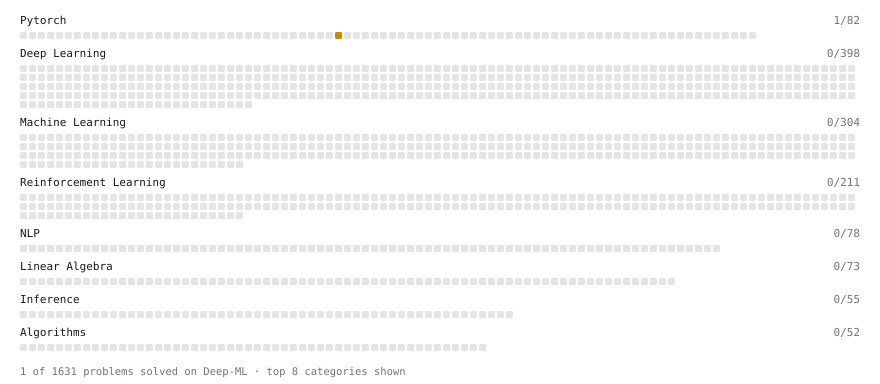

# Deep-ML

My machine learning practice from [Deep-ML](https://www.deep-ml.com). Every solution here was written by hand.

**1** solved · 0 problems · 1 labs · 0 math

[**Browse the interactive portfolio**](https://sachinumrao.github.io/deep-ml/) to replay this filling in over time.

## Labs

| | Difficulty | Solved | |
| --- | --- | --- | --- |
| [Fit Linear Regression with Autograd](https://www.deep-ml.com/labs/9ff596ea-672e-4101-9ce4-0856c55b62c9) | medium | 2026-10-21 | [solution](labs/9ff596ea-672e-4101-9ce4-0856c55b62c9-fit-linear-regression-with-autograd) |

---

_This file is regenerated by Deep-ML on every push._
